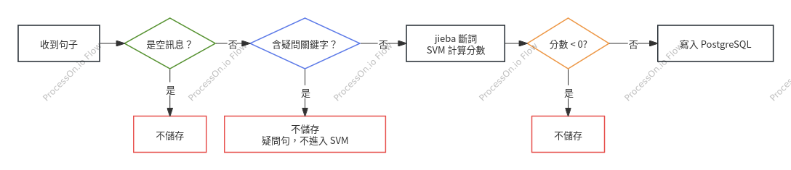

# BackEnd（PythonEnd）

> Diet JARVIS 的 Python 後端：接收 n8n 傳來的語句，先判斷這句話「值不值得記錄」，再決定是否寫入 PostgreSQL 的 `diet_notes` 資料表。
>
> **此後端主要用來判斷使用者的需求需不需要寫進資料庫中。**

對應 docker-compose 中的 `python_app` 服務（容器 `python_backend_dev`）。整體架構與 n8n 流程請見 docker_space 的 README。

---

## 功能概覽

1. **疑問句過濾**：句子含疑問關鍵字（`？`、`?`、什麼、啥、嗎、怎麼、多少、好不好、為何、為什麼、為甚麼）就不儲存。
2. **jieba + SVM 二分類**：用 jieba 斷詞，再以訓練好的 SVM 模型（`svm+jieba.joblib`）計算 `decision_function` 分數。分數 > 0 表示是需要記錄的飲食語句，否則略過。
3. **寫入資料庫**：判斷需儲存者，寫入 PostgreSQL 的 `diet_notes`（欄位 `note`、`eaten_at`），回傳新資料列的 `id`。

### 收到句子後如何判斷



## 檔案結構

| 檔案 | 說明 |
|------|------|
| `Flask_dev.py` | Flask 傳輸層（port 5000）：提供 API，接收請求並回傳結果 |
| `Flask_5498.py` | 核心邏輯：疑問句過濾、SVM 判斷、寫入資料庫 |
| `svm+jieba.joblib` | 訓練好的模型，需與程式放在同一資料夾（或用 `MODEL_PATH` 指定） |
| `requirements.txt` | 相依套件 |
| `Dockerfile` | 映像檔建置（`python:3.10-slim`，啟動指令 `python Flask_dev.py`） |

## API

### `GET/POST /health`
健康檢查，回傳 `{"status": "ok"}`。

```bash
curl -i -X POST http://localhost:5000/health
```

### `POST /process`
正式流程：判斷並視情況存入資料庫。

請求（`text` 欄位亦可代替 `usr_sentence`）：

```json
{"usr_sentence": "我今天早上吃了鮪魚蛋餅跟無糖豆漿"}
```

回應：

| 情況 | HTTP | 回應 |
|------|------|------|
| 已存入 | 200 | `{"status":"ok","stored":true,"id":<新id>,"score":<分數>,"eaten_at":<時間>}` |
| 判斷不存 | 200 | `{"status":"skipped","stored":false,"score":<分數或null>,"message":<原因>}` |
| 沒收到文字 | 400 | `{"status":"error","message":"沒有收到文字"}` |
| 寫入失敗 | 500 | `{"status":"error","message":"寫入資料庫失敗: ..."}` |

> 被疑問句過濾攔下時，`score` 為 `null`（尚未跑 SVM）。

### `POST /svm_test`
只測試判斷，**不寫入資料庫**，方便調整模型。

```bash
curl -X POST http://localhost:5000/svm_test \
  -H "Content-Type: application/json" \
  -d '{"usr_sentence": "我今天中午吃了牛肉麵"}'
```

回傳 `is_question`、SVM 原始 `score`、`svm_label`、`would_store`，且 `stored` 永遠為 `false`。

## n8n 設定

`to_background` 節點（HTTP Request）：

| 項目 | 設定 |
|------|------|
| Method | `POST` |
| URL | `http://python_app:5000/process`（同一個 compose 網路內） |
| Body | JSON：`{"usr_sentence": "..."}` |

> `Flask_dev.py` 的註解寫的是 `http://host.docker.internal:5000/process`，那是從容器連到主機上執行的 Flask 時使用；Flask 跑在 compose 內時，請用服務名稱 `python_app`。

## 環境變數

| 變數 | 預設值 | 說明 |
|------|--------|------|
| `PG_HOST` | `localhost` | 資料庫主機。Flask 跑在 compose 內時請設為 `postgres_dev` |
| `PG_PORT` | `5432` | 資料庫 port |
| `PG_DB` | `nutrition` | 資料庫名稱 |
| `PG_USER` | （見程式碼） | 資料庫帳號 |
| `PG_PASSWORD` | （見程式碼） | 資料庫密碼 |
| `MODEL_PATH` | 與程式同資料夾的 `svm+jieba.joblib` | 模型路徑 |

資料表設定在 `Flask_5498.py` 開頭：`TABLE_NAME = "diet_notes"`、`NOTE_COLUMN = "note"`、`TIME_COLUMN = "eaten_at"`。

## 執行方式

### 在 Docker 中（建議）

於 docker-compose 所在資料夾：

```bash
docker compose up -d --build python_app
```

### 在本機直接執行

```bash
pip install -r requirements.txt
python Flask_dev.py
```

此時 `PG_HOST` 預設的 `localhost` 可直接連到 compose 開出來的資料庫（需確認 `postgres` 有對外開 5432 port）。

## 注意事項

- `FIXED_TIME`（目前為 `2026-10-01`）是**測試用固定時間**，所有寫入的 `eaten_at` 都會是這個值；正式上線請改成 `datetime.now()`。
- 模型以 `jieba_tokenizer` 訓練並存成 joblib，載入時必須有同名函式並掛回 `__main__`，程式已處理，更換模型時請維持同名切詞函式。
- 程式碼中直接寫了資料庫帳號與密碼的預設值。上傳 GitHub 前，請改為只從環境變數讀取，並更換該密碼。
