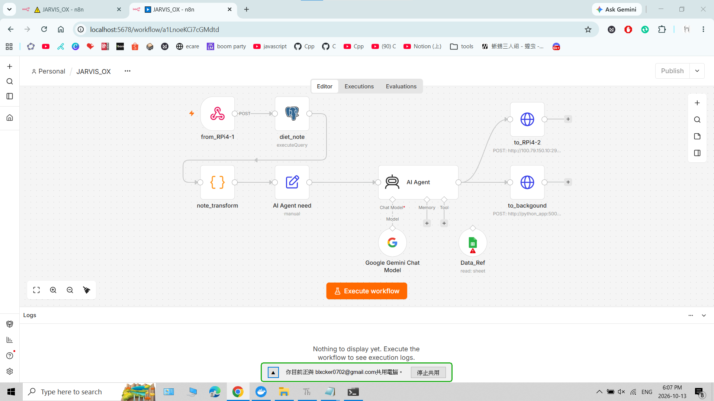

# 116-Project_Docker-Space

> **Diet JARVIS** 專題中 **Docker 環境（docker_space）** 的功能說明：以 Docker Compose 一次啟動資料庫、資料庫管理介面、n8n 工作流程與 Python 後端。

---

## docker_space 在本作品中的角色

Diet JARVIS 分為三個部分，docker_space 屬於 **PC 端（Memory & Thinking）**：

| 裝置 | 角色 |
|------|------|
| RPi4-1 | Listening & Speaking：KWS + STT、TTS |
| RPi4-2 | Looking：YOLO 影像偵測 |
| **PC（本儲存庫）** | **Memory & Thinking：以 Docker 提供記憶（資料庫）與思考（n8n + AI Agent）** |

## 服務組成

| 服務 | 映像／來源 | 容器名稱 | Port | 在本作品中的功能 |
|------|-----------|----------|------|------------------|
| `postgres` | `postgres:16-alpine` | `postgres_dev` | 僅內部網路 | 儲存飲食紀錄（`diet_records.csv`），同時作為 n8n 的資料庫 |
| `adminer` | `adminer` | `adminer_dev` | `8080` | 資料庫網頁管理介面，用來檢視與匯入飲食紀錄 |
| `n8n` | `n8nio/n8n:latest` | `n8n_dev` | `5678` | 工作流程核心：接收語音語句、寫入／讀取資料庫、呼叫 AI Agent、分派結果 |
| `python_app` | `./python_backend`（本地 build） | `python_backend_dev` | `5000` | **PythonEnd**：用來編輯 PostgreSQL 的後端（詳見該資料夾內的 README） |

> `postgres` 沒有對外開 port，其他服務以主機名稱 `postgres_dev` 在 compose 內部網路連線。

## 資料放置位置

| 資料 | 存放位置 | 用途 |
|------|----------|------|
| `diet_records.csv` | **PostgreSQL** | 飲食紀錄（語音語句＋時間）。AI Agent 每次檢視最近 21 筆 |
| `foods_ref.csv` | **Google Sheets** | 食物營養參考表，由 n8n 的 `Data_Ref` 節點讀取 |

### `diet_records.csv`（PostgreSQL）

共 89 筆，**無標題列**，逗號分隔，兩欄：

| 欄位 | 說明 | 範例 |
|------|------|------|
| 1 | 語音辨識後的飲食語句 | `我今天早上吃了鮪魚蛋餅跟無糖豆漿` |
| 2 | 時間（ISO 8601） | `2026-09-01T08:15:00` |

### `foods_ref.csv`（Google Sheets）

共 135 筆，原檔以分號（`;`）分隔，匯入 Google Sheets 時請注意分隔符號設定。

| 欄位 | 說明 |
|------|------|
| `id` | 編號 |
| `name` | 食物名稱 |
| `aliases` | 別名 |
| `category` | 分類（早餐類、湯品類、飲品類、飯食類 等） |
| `kcal` | 熱量 |
| `protein` | 蛋白質（g） |
| `fat` | 脂肪（g） |
| `carb` | 碳水化合物（g） |

## n8n 工作流程（JARVIS_OX）



1. **`from_RPi4-1`**（Webhook, POST）：接收 RPi4-1 語音辨識後的飲食語句。
2. **`diet_note`**（PostgreSQL）：把語句與時間寫入資料庫，並取出最近的飲食紀錄。
3. **`note_transform`**（Code）：整理查詢結果。
4. **`AI Agent need`**（Edit Fields）：組合 Agent 所需的輸入。
5. **`AI Agent`**：使用 Google Gemini Chat Model，並透過 **`Data_Ref`**（Google Sheets）查詢食物營養參考表。
6. 輸出兩路：
   - **`to_RPi4-2`**（HTTP POST）：將結果傳給 RPi4-2。
   - **`to_background`**（HTTP POST）：將結果傳給 `python_app`（`http://python_app:5000`），由 PythonEnd 負責編輯 PostgreSQL。

## 快速開始

### 1. 建立 `.env`

與 `docker-compose.yaml` 同一層：

```env
POSTGRES_USER=your_user
POSTGRES_PASSWORD=your_password
POSTGRES_DB=nutrition
N8N_ENCRYPTION_KEY=your_random_secret_key
```

> ⚠️ `.env` 含有帳密與加密金鑰，請勿上傳 GitHub（加入 `.gitignore`）。`N8N_ENCRYPTION_KEY` 設定後請勿更換，否則 n8n 內已儲存的憑證會無法解密。

### 2. 啟動

```bash
docker compose up -d --build
```

### 3. 開啟介面

| 介面 | 網址 |
|------|------|
| n8n | http://localhost:5678 |
| Adminer | http://localhost:8080（系統選 PostgreSQL，伺服器填 `postgres_dev`） |
| PythonEnd | http://localhost:5000 |

### 4. 設定

1. 在 Adminer 建立資料表並匯入 `diet_records.csv`。
2. 將 `foods_ref.csv` 匯入 Google Sheets。
3. 在 n8n 匯入 `JARVIS_OX`，並設定 PostgreSQL、Google Gemini、Google Sheets 的憑證。
4. 確認 `to_RPi4-2` 的目標網址，以及 RPi4-1 呼叫 Webhook 的位址。

## 相關說明

- PythonEnd（`python_backend/`）的功能與 API 請見該資料夾內的 README。
